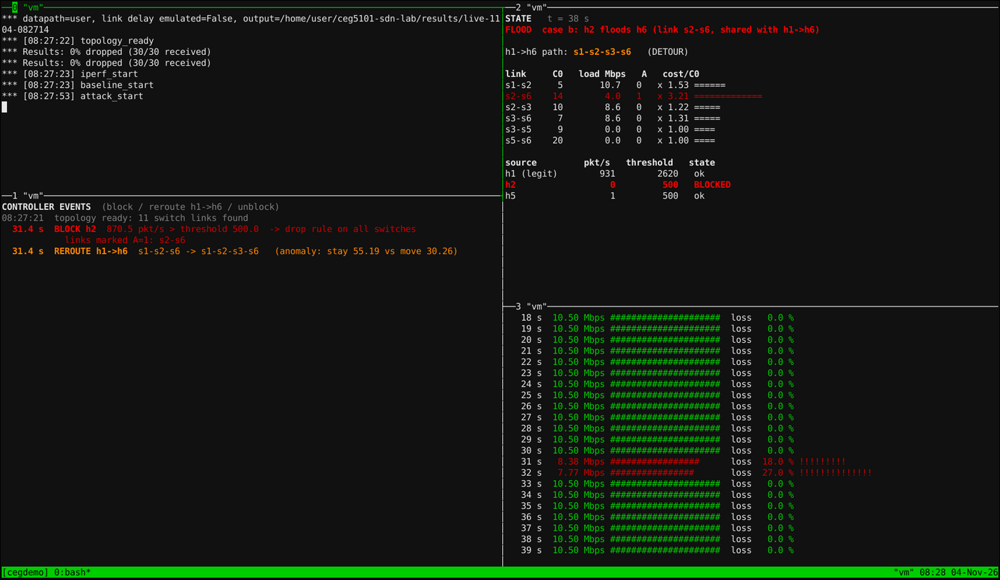

> 现场要真的跑一遍，而不是只放幻灯片。幻灯片保留，用来讲设计和三次重复实验的结论。演示的核心是**一条命令跑完整个实验**，屏幕分四格实时显示，跑完当场出结果表和总览图。这比现场手敲命令稳得多：时间线、流量和攻击都由脚本控制，你们只需要讲解。
>
> A = **Yang Kaiming**（系统与检测，负责操作电脑），B = **Chen Danze**（路由与结果）。

## 1. 演示长什么样

```bash
$ cd ~/ceg5101-sdn-lab
$ bash code/demo/live_demo.sh          # 完整：case a、b、c，约 5–6 分钟
$ bash code/demo/live_demo.sh quick    # 只跑 case b，约 2.5 分钟（时间不够时用）
```

终端被分成四格（已在官方 Mininet VM 和容器里实测）：

| 位置 | 显示什么 | 讲解时指着它说 |
|---|---|---|
| 左上：**实验进度** | 时间点：`topology_ready` → `pingall` → `baseline_start` → 每个 case 的 `attack_start` / `attack_end` → `end`；结束后自动打印本次运行的结果表 | “现在开始洪泛” |
| 左下：**控制器事件** | 红色 `BLOCK h2 … pkt/s > threshold … drop rule on all switches` 和被标记的链路；橙色 `REROUTE h1->h6 … stay 56.6 vs move 30.2`；绿色 `UNBLOCK` | 控制器的每一个决定 |
| 右上：**状态板**（每秒刷新） | 当前阶段；h1→h6 走哪条路（蓝色主路 / 橙色 DETOUR）；6 条关键链路的负载、A、代价倍数（×3.14 那种）；h1、h2、h5 的速率、阈值、是否 BLOCKED | 代价跳升、路径切换 |
| 右下：**接收端 h6** | h1→h6 每秒吞吐和丢包，带条形图；丢包时变红 | 丢包只出现在检测前那一两秒 |

实际画面（case b 刚被检测到的那一刻：左下 BLOCK 和 REROUTE，右上 h1→h6 已在 DETOUR、s2-s6 被标为 A=1，右下只有两秒红色丢包）：



结束后左上会出现：

```
case  detected in blocked  links marked A=1  h1->h6 rerouted              worst 1s loss  loss after block
a     2.2 s       h2       s2-s3             no                           0.0 %          0 %
b     1.6 s       h2       s2-s6             yes -> s1-s2-s3-s6 (+ back)  11.0 %         0 %
c     3.8 s       h5       s3-s5, s3-s6      no                           10.0 %         0 %
```

（这是我们在 VM 上的一次结果。每次运行检测延迟和丢包会不一样，但**谁被封、标记哪些链路、只有 b 改路由**每次都一样。）

然后输入 `python3 code/demo/show_figure.py results/live-…`（左上已经打印好这条命令，复制即可），弹出总览图：路径色带、代价、丢包、吞吐、RTT 五个面板，Esc 关闭。需要图形界面，第 6 节有说明。

## 2. 25 分钟时间段怎么排（建议，先和 GA 确认讲多久）

假设正文约 15 分钟、问答约 8 分钟、换场 2 分钟：

| 时间 | 内容 | 谁讲 | 谁操作 |
|---|---|---|---|
| 0:00–3:00 | 幻灯片 S1–S4：开场 48%→0%、拓扑、控制环、检测与封禁 | Kaiming | Kaiming 翻页 |
| 3:00–5:00 | 幻灯片 S5–S6：代价公式、改路由规则 | Danze | Kaiming 翻页 |
| 5:00–5:30 | 切到终端，启动 `bash code/demo/live_demo.sh`，说明四格各是什么 | Kaiming | Kaiming |
| 5:30–11:00 | **现场实验**（按第 3 节的台词讲解） | case a：Kaiming；case b、c：Danze | Kaiming |
| 11:00–12:00 | 结果表 + 总览图 | Danze | Kaiming 打开图 |
| 12:00–14:00 | 切回幻灯片 S9（三次重复的检测和封禁）、S11（Task 5 全程图）、S13（β 和断链） | Kaiming 讲 S9，Danze 讲 S11、S13 | Kaiming |
| 14:00–15:00 | S14 局限与结论 | Kaiming 前半，Danze 收尾 | — |
| 15:00– | Q&A（检测、封禁、环境归 Kaiming；代价、路由、图表归 Danze） | 两人 | — |

幻灯片 S7、S8、S10、S12 的内容由现场演示代替：S7（实验方法）在启动演示时口头讲，S8 的录屏留作备用，S10 和 S12 的内容现场能直接看到。

**如果只给 10–12 分钟**：幻灯片只讲 S1、S2、S5，现场用 `quick` 模式（只跑 case b，2.5 分钟），然后 S11、S14。

## 3. 现场讲解台词（完整模式，按屏幕上出现的内容讲）

时间是“从 `baseline_start` 起”的大约秒数，右上状态板顶部显示的就是这个时间。

| 屏幕上看到 | 约在 | 谁说 | 说什么 |
|---|---|---|---|
| 启动 | 0 | Kaiming | *"This is the real network on our Mininet VM: six OVS switches, our Ryu controller, and the link delays from the topology file. One script runs the whole timeline: normal traffic, then three floods. Top left is the timeline, bottom left the controller's decisions, top right its state, bottom right what h6 receives from h1."* |
| `topology_ready`、`pingall` | 启动后 10–20 s | Kaiming | *"The controller has discovered all 11 links over LLDP, and pingall reaches all 30 pairs. Now h1 sends 10 megabits of UDP to h6, the flow we protect."* |
| 基线，右下每秒 10.5 Mbps、0% | 0–40 s | Kaiming | *"Normal state: 10.5 megabits, zero loss. h1 to h6 is on the shortest path s1-s2-s6, top right. Every source is learning its baseline."* |
| `attack_start`（case a） | ≈40 s | Kaiming | *"Case a: h2 floods h3 over s2–s3, a link our flow does not use."* |
| 红色 `BLOCK h2` | ≈42–44 s | Kaiming | *"Within one or two polls the controller sees h2 far above its threshold and installs a drop rule on all six switches. s2–s3 is marked A equals 1: top right, its cost jumps to about four times. Our flow is not on that link, so it stays where it is, and the receiver shows zero loss."* |
| 状态板 s2-s3 ×4.0，h1 路径不变 | 45–65 s | Kaiming → Danze（交接） | Kaiming：*"So the attacker is stopped. But what happens when the flood hits our own path? Danze?"* |
| `attack_start`（case b） | ≈110 s | Danze | *"Thanks, Kaiming. Case b: h2 floods h6 over s2–s6, the link our flow uses. Watch bottom right."* |
| 右下 1–2 秒变红（丢包） | ≈110–113 s | Danze | *"These red seconds are the detection delay: the flood shares s2–s6 with our flow and the queue overflows."* |
| 红色 `BLOCK h2` + 橙色 `REROUTE h1->h6 … s1-s2-s3-s6` | ≈112–114 s | Danze | *"In the same control interval: h2 is blocked, s2–s6 is marked, its cost jumps to about 3.5 times, and our flow moves to s1-s2-s3-s6, because staying would cost far more than moving: here the two numbers on screen, about 55 against 30. Bottom right: back to zero loss."* |
| 状态板 s2-s6 稳定在 ×3.14 | 115–135 s | Danze | *"The flood load is gone after the block, yet the cost holds at 3.14: fourteen plus thirty, over fourteen. That is the anomaly term: it keeps traffic off the attacked link while h2 is still hitting its drop rule."* |
| `attack_end`，约 12 s 后绿色 `UNBLOCK` + 橙色 `REROUTE … -> s1-s2-s6` | ≈148–152 s | Danze | *"The flood stopped; after ten quiet seconds h2 is unblocked, the mark clears, and our flow moves back to the shortest path. Exactly two reroutes: away and back."* |
| `attack_start`（case c） | ≈180 s | Danze | *"Case c: h5 floods h6. By cost it goes s5-s3-s6, sixteen against twenty, so the controller marks s3–s5 and s3–s6, not s5–s6. Our flow is on neither, so not moving is the correct answer. The small loss you may see is the shared access link into h6, which no route can avoid; the block ends it."* |
| `end`，左上出现结果表 | ≈255 s + 画图 | Danze | *"Here is this run's result: every attacker detected in seconds and blocked, only case b rerouted, and loss only before each detection."* |
| 打开总览图 | — | Danze | *"The same run as graphs: the path band, the cost of each attacked link, loss, throughput and RTT. We repeated this three times with the same behaviour; the slides show those runs."* |

等待时间里（基线、恢复阶段）不要冷场，可以讲：
- Kaiming：检测规则为什么是 max(3b, b+4σ, 500)；为什么不统计 echo reply；为什么先比较再更新基线。
- Danze：代价公式 C = C0 + 10·R/40 + 30·A；what-if 和 margin 2 防振荡；先装出口再装入口。

## 4. 准备清单

**前一天（D-1）**
- [ ] 在 Kaiming 的电脑上把完整模式跑一遍、`quick` 模式跑一遍，确认四格都正常、结果表三个 case 都 blocked、只有 b 改路由。
- [ ] 跑一次 `python3 code/demo/show_figure.py results/live-…`，确认能弹出图（需要 X，见第 6 节）。
- [ ] 终端字号调到投影能看清（建议 16–18 号），全屏后至少 160 列宽、45 行高，四格才不挤。
- [ ] 电脑电源、HDMI / USB-C 转接头、备用 U 盘（幻灯片单文件 HTML + 讲稿 PDF）。
- [ ] 两人按第 3 节的台词完整彩排一次，掐时间。

**当天到场（10:00 前）**
- [ ] 开 VM，用终端 `ssh -Y` 登录（Windows：MobaXterm；Mac：先打开 XQuartz），`cd ~/ceg5101-sdn-lab`。
- [ ] `sudo -v`（先输一次密码，演示时不用再输），`sudo mn -c`（清理残留）。
- [ ] 浏览器打开幻灯片 `presentation/source/CEG5101_CA2_Group5_light.html`，按 F11 全屏，停在第 1 页。
- [ ] 终端窗口准备好，命令 `bash code/demo/live_demo.sh` 先打好、不按回车。
- [ ] 试投影：终端字是否看得清。

## 5. 出问题怎么办

| 情况 | 处理 |
|---|---|
| 启动后 30 秒还没出现 `topology_ready` | 按 Ctrl-b 再按 d 退出 tmux，`sudo mn -c`，重新运行一次。还不行就放幻灯片第 8 页的录屏（case b 真实运行），照第 3 节 case b 的台词讲 |
| 洪泛开始后 **60 秒**内没看到 BLOCK | 不要现场调试，直接切到第 8 页录屏 |
| h1 一开始就被 BLOCK（状态板 h1 显示 BLOCKED） | warm-up 太短。退出、`sudo mn -c`，用 `CEG_WARMUP=15 bash code/demo/live_demo.sh` 重跑；时间不够就放录屏 |
| 时间不够 | 用 `quick` 模式；或完整模式跑到 case b 回切后就按 Ctrl-c 结束，直接讲结果（结果表只有跑完才会出现，所以这种情况改用幻灯片 S11 讲） |
| 总览图弹不出来 | 没有 X 显示。改为切回幻灯片 S11（同样的五面板图，是 R1 的结果），说明“和刚才这次是同一种图” |
| 实验跑到一半中断、之后什么都不通 | `sudo mn -c` 和 `sudo pkill -f ryu-manager`，再重跑 |
| 老师要求手动敲命令演示 | 用技术支持文档里的“手动演示命令卡”（两个终端：控制器 + Mininet CLI） |

## 6. 环境说明（给 Kaiming）

- 演示必须在**能跑 Mininet 的 VM** 里：Windows 或 Intel Mac 用 VirtualBox 跑官方 Mininet VM；Apple Silicon Mac 用 UTM 跑 ARM 版 Ubuntu。详见 [Windows 技术支持](../../docs/environment/Tech_Support_Windows_zh.pdf)和 [Mac 技术支持](../../docs/environment/Tech_Support_Mac_zh.pdf)。
- 安装脚本 `support/environment/setup_ubuntu.sh` 已经包含 tmux。如果你的 VM 是更早装的，补一句 `sudo apt install -y tmux`。
- `live_demo.sh` 会自己用 sudo 提权，结果存在 `results/live-月日-时分秒/`，跑完会把文件所有者改回你。
- 看总览图需要图形显示：用 `ssh -Y` 从有 X 的终端登录（MobaXterm / XQuartz），或者在有桌面的 VM 里直接运行。
- 在你们的 VM 上（有硬件虚拟化），洪泛会比我们在纯软件模拟的 VM 里更猛，case b 检测前的丢包可能到 30–50%（和报告里 R1–R3 一样），这是正常的，正好说明检测延迟就是丢包的来源。
